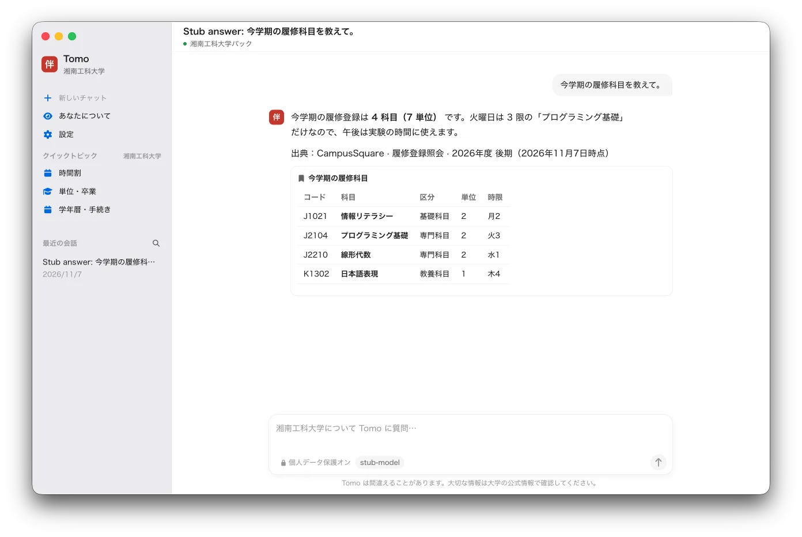
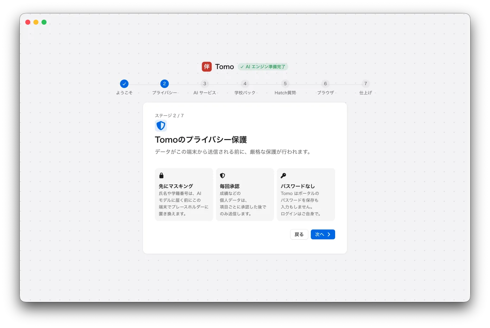
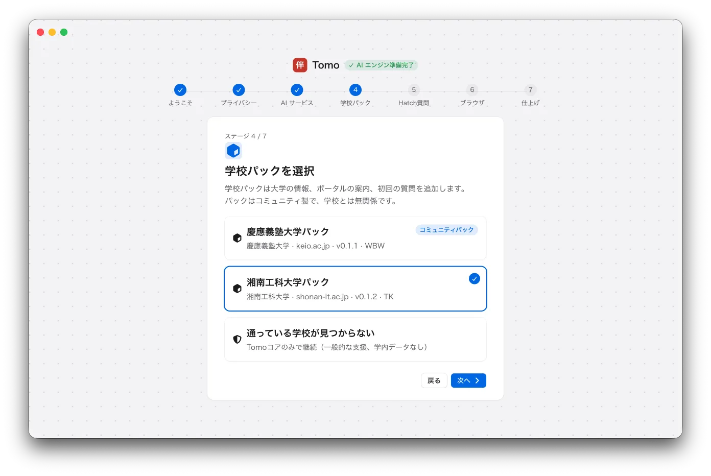
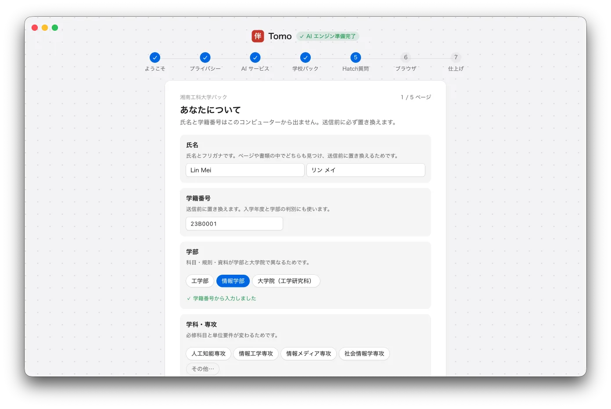
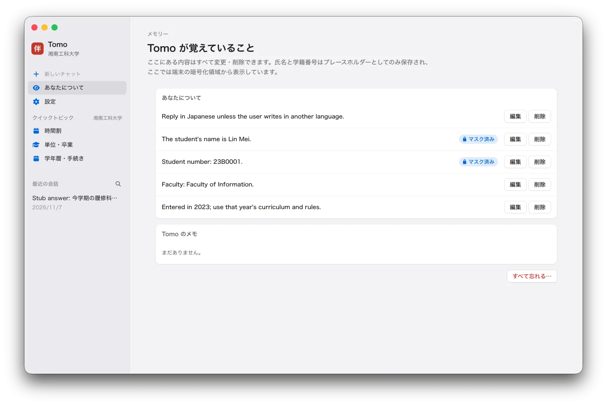

# Tomo（伴）

[English](README.md) · [简体中文](README.zh-CN.md) · **日本語**

日本で学ぶ留学生のためのデスクトップ・パートナーです。授業・学校の規則・手続きについての質問に答え、日本語の学習を手伝い、学生に見えるブラウザで学校のサイトを使うこともできます。Windows
と macOS に対応し、日本語・中国語・英語で話せます。

<p align="center"></p>

ダウンロード：[tomo.gakuen.ac](https://tomo.gakuen.ac/) または [GitHub Releases](https://github.com/tkyu-labs/tomo/releases)。

## しくみ

Tomo 自体は特定の学校を知りません。[tomo-packs](https://github.com/tkyu-labs/tomo-packs) の**学校パック**が、学校ごとの情報・スキル・初回の質問を追加します。エージェントのエンジンは
[Hermes Agent](https://github.com/NousResearch/hermes-agent) で、固定したリリース（`scripts/hermes-pin.env`）を改変せずに使い、標準入出力で動かします。Tomo
はネットワークのポートを一切開きません。

初回起動では、プライバシーの説明、AI サービスの接続、学校パックの選択、あなたについてのいくつかの質問を順に進めます：

<table>
  <tr>
    <td width="33%"></td>
    <td width="33%"></td>
    <td width="33%"></td>
  </tr>
  <tr>
    <td align="center">プライバシーを三行で</td>
    <td align="center">学校パックを選ぶ</td>
    <td align="center">あなたについての質問</td>
  </tr>
</table>

## プライバシー

- 氏名・学籍番号などの識別情報は、エンジンやモデルに届く前に必ず `{{プレースホルダー}}` に置き換え、実際の値は画面の上でだけ表示します。
- 成績や自己判定などの個人データは、学生が許可したときだけ読み取ります。決めるのは一度だけ（初回の質問、または最初に必要になったとき）で、設定でいつでも変更できます。使った回答にはそのことを表示します。
- Tomo が覚えたことは、すべて確認・修正・削除できます。
- API キーは OS の暗号化ストレージに保存し、エンジンのファイルには書き込みません。
- ポータルのパスワードは保存も入力もしません。ログインは学生自身が Tomo のブラウザで行います。

<p align="center"></p>

## 開発

必要なもの：Node.js 22 以上、[uv](https://docs.astral.sh/uv/)、Git。

```sh
scripts/dev-hermes.sh          # 固定バージョンの Hermes を .dev/ に用意（~/.hermes とは分離）
source scripts/dev-env.sh      # プロジェクト内のキャッシュと HERMES_HOME
npm install
npm run dev                    # アプリを起動
npm test && npm run typecheck && npm run lint
```

開発に使うもの（Hermes のソース、Python 環境、データ、キャッシュ）はすべて `.dev/` にあり、コミットしません。ビルドとリリースは `BUILDING.md`、貢献の手引き（人とコーディングエージェント向け）は
`AGENTS.md` を参照してください。

スクリーンショットは架空の学生（Lin Mei）と、台本どおりに答えるテスト用モデルによるものです。

## ライセンス

MIT（`LICENSE`）。
