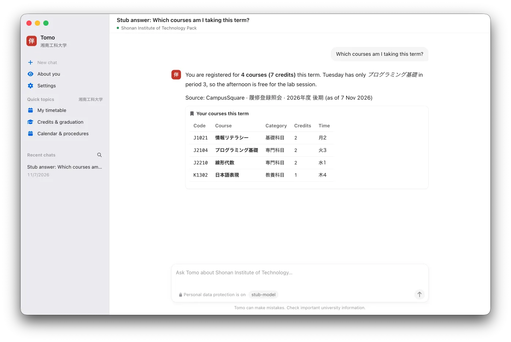
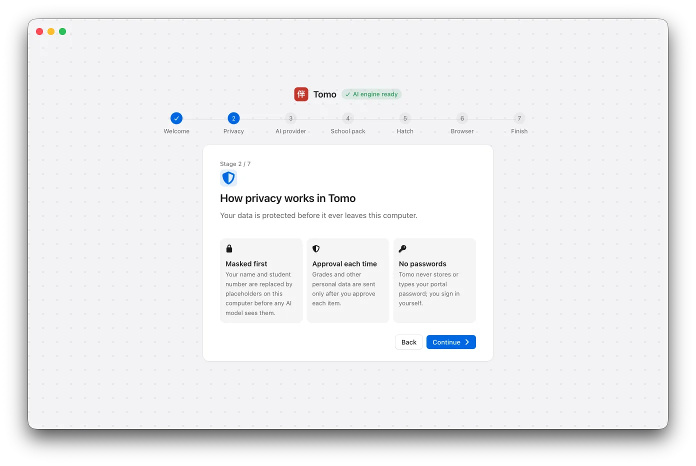
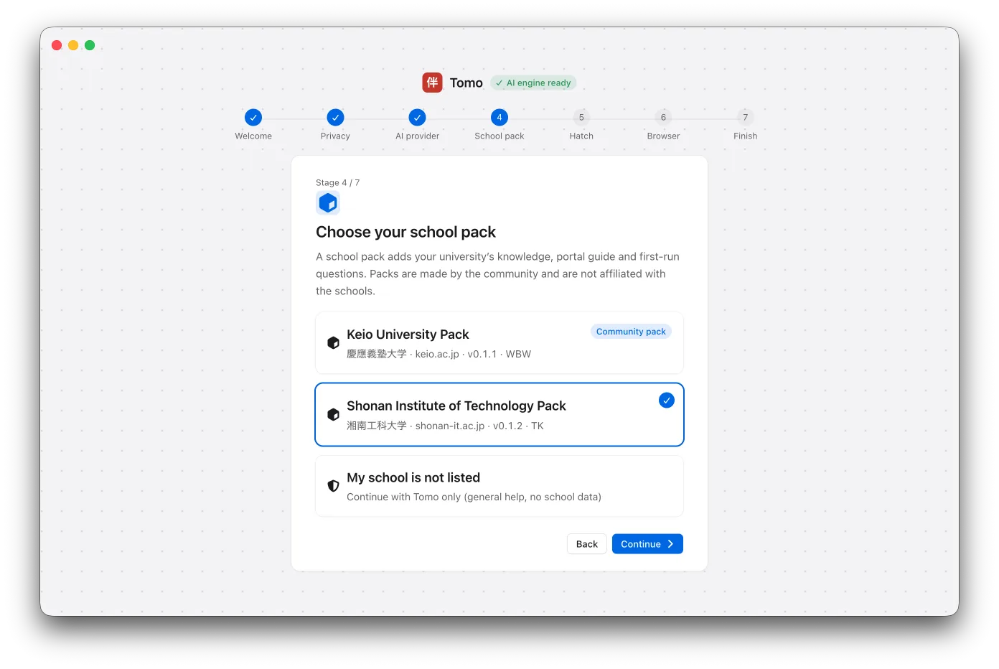
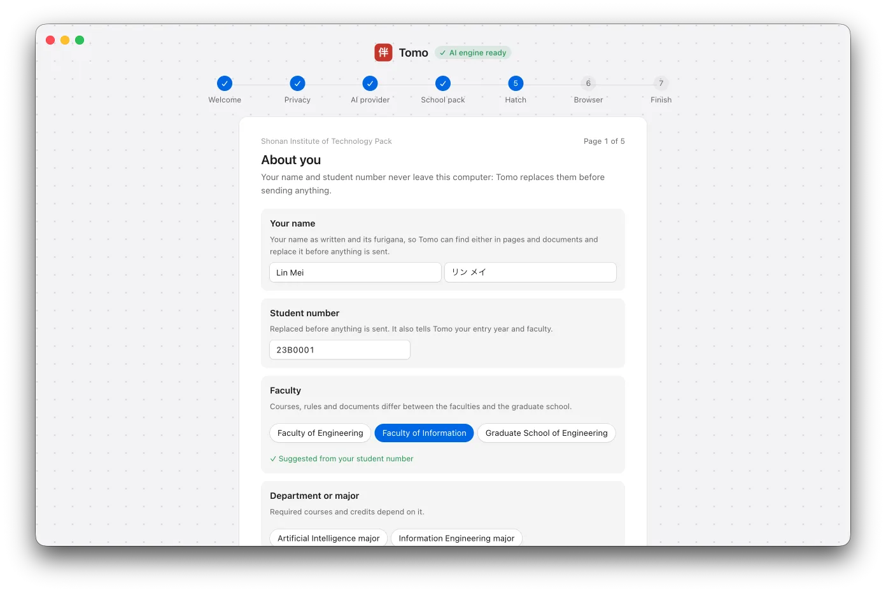
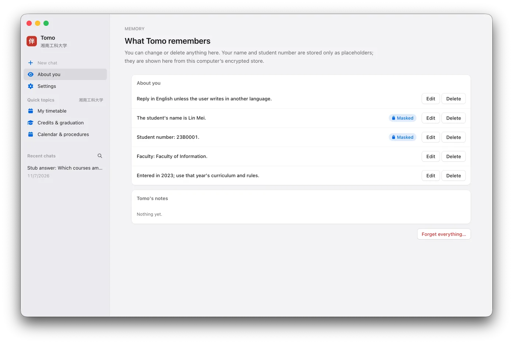

# Tomo（伴）

**English** · [简体中文](README.zh-CN.md) · [日本語](README.ja.md)

A desktop companion for international students in Japan. Tomo answers questions about courses, school rules and
procedures, helps with Japanese, and can use the school's sites in a browser window the student can see. It runs on
Windows and macOS and speaks Japanese, Chinese and English.

<p align="center"></p>

Download: [tomo.gakuen.ac](https://tomo.gakuen.ac/en/) or [GitHub Releases](https://github.com/tkyu-labs/tomo/releases).

## How it works

Tomo is school-agnostic; a school **pack** from [tomo-packs](https://github.com/tkyu-labs/tomo-packs) adds one
school's knowledge, skills and first-run questions. The agent engine is [Hermes Agent](https://github.com/NousResearch/hermes-agent),
used unmodified at a pinned release (`scripts/hermes-pin.env`) and driven over stdio — Tomo opens no network port.

The first start walks through privacy, the AI service, the school pack and a few questions about the student:

<table>
  <tr>
    <td width="33%"></td>
    <td width="33%"></td>
    <td width="33%"></td>
  </tr>
  <tr>
    <td align="center">Privacy, in three lines</td>
    <td align="center">Choose your school pack</td>
    <td align="center">A few questions about you</td>
  </tr>
</table>

## Privacy

- Identifiers (name, student number) are replaced by `{{PLACEHOLDERS}}` before anything reaches the engine or a
  model, and shown as real values only on screen.
- Other personal data (grades, self-checks) is read only if the student allows it: decided once (in the first-run
  questions or the first time it is needed) and changeable in Settings; each answer that used it says so.
- Everything Tomo remembers is visible, editable and deletable.
- API keys are kept in the operating system's encrypted storage and never written to the engine's files.
- Tomo never stores or types portal passwords; the student signs in in Tomo's own browser window.

<p align="center"></p>

## Development

Requirements: Node.js 22+, [uv](https://docs.astral.sh/uv/), Git.

```sh
scripts/dev-hermes.sh          # pinned Hermes in .dev/ (isolated from any ~/.hermes)
source scripts/dev-env.sh      # project-local caches and HERMES_HOME
npm install
npm run dev                    # start the app
npm test && npm run typecheck && npm run lint
```

Everything for development (Hermes checkout, Python environment, data, caches) lives in `.dev/`, which is not
committed. Builds and releases: `BUILDING.md`. Contributing (people and coding agents): `AGENTS.md`.

The screenshots show a fictional student (Lin Mei) and a scripted test model.

## Licence

MIT (`LICENSE`).
