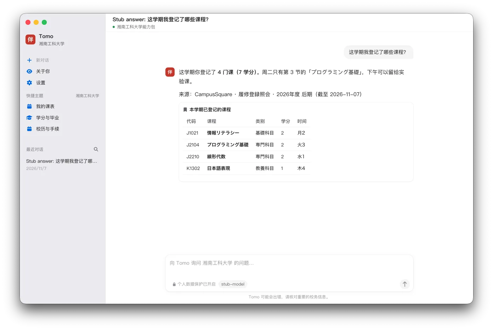
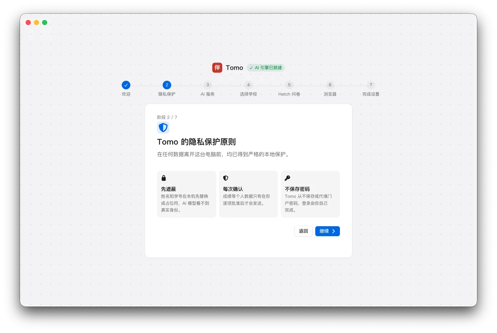
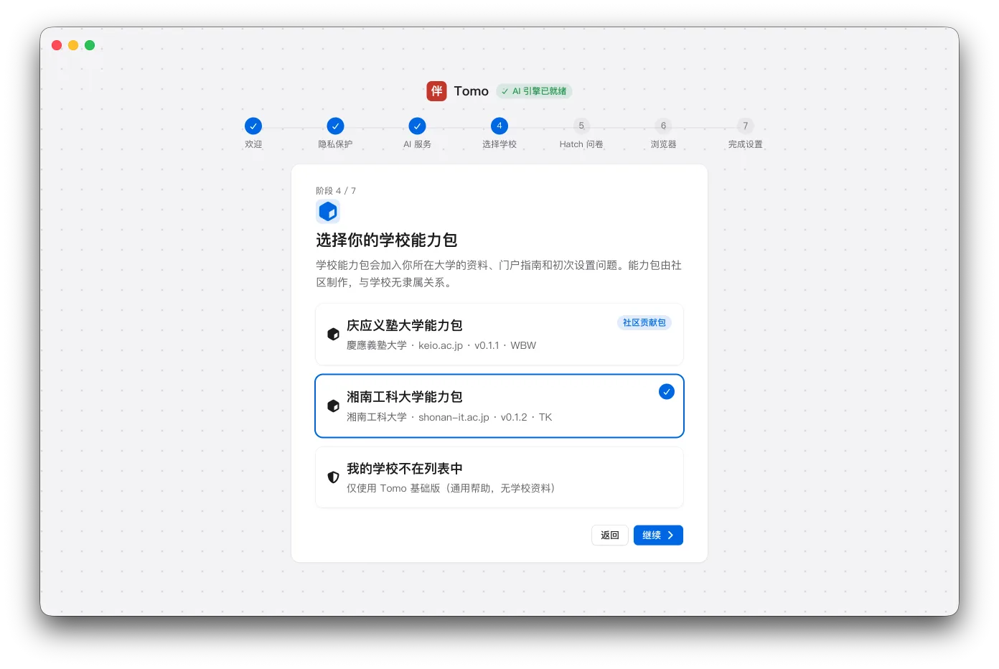
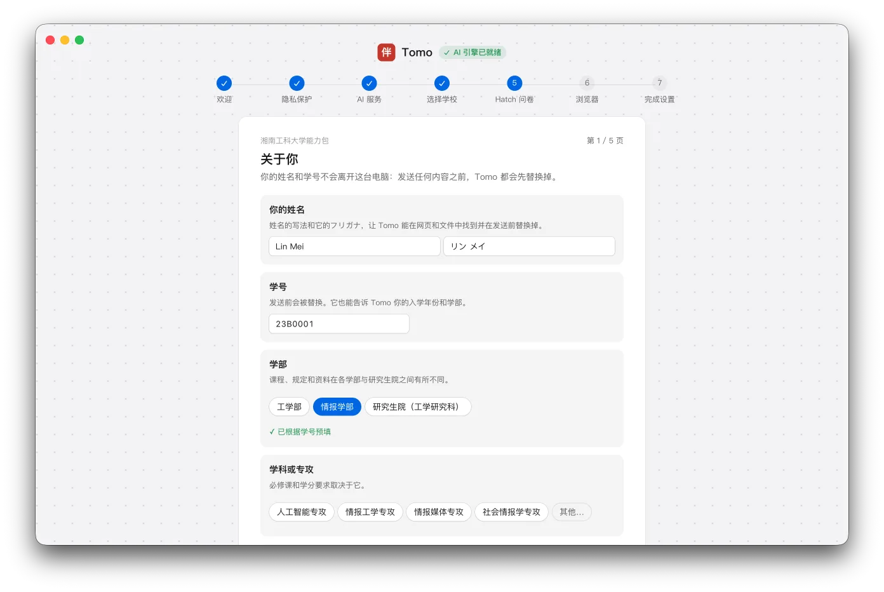
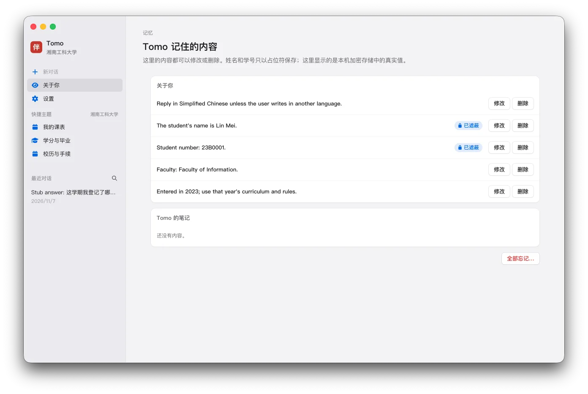

# Tomo（伴）

[English](README.md) · **简体中文** · [日本語](README.ja.md)

为在日留学生打造的桌面伙伴。Tomo 回答关于课程、校规和各种手续的问题，帮你学日语，还能在你看得见的浏览器窗口里使用学校的网站。支持
Windows 和 macOS，可以用中文、日语和英语交流。

<p align="center"></p>

下载：[tomo.gakuen.ac](https://tomo.gakuen.ac/zh/) 或 [GitHub Releases](https://github.com/tkyu-labs/tomo/releases)。

## 工作方式

Tomo 本身不针对任何学校；来自 [tomo-packs](https://github.com/tkyu-labs/tomo-packs) 的学校**能力包**会加入某一所学校的资料、技能和初次设置的问题。智能体引擎是
[Hermes Agent](https://github.com/NousResearch/hermes-agent)，以锁定的版本（`scripts/hermes-pin.env`）原样使用，通过标准输入输出驱动——Tomo
不开放任何网络端口。

首次启动时会依次完成隐私说明、连接 AI 服务、选择学校能力包，以及回答几个关于你的问题：

<table>
  <tr>
    <td width="33%"></td>
    <td width="33%"></td>
    <td width="33%"></td>
  </tr>
  <tr>
    <td align="center">三句话讲清隐私</td>
    <td align="center">选择你的学校能力包</td>
    <td align="center">几个关于你的问题</td>
  </tr>
</table>

## 隐私

- 姓名、学号等身份信息在交给引擎或模型之前，一律替换成 `{{占位符}}`，只在屏幕上显示真实值。
- 成绩、自我检查等其他个人数据，只有在学生允许时才会读取：只需决定一次（在初次设置的问题里，或第一次需要时），之后可以在设置里修改；用到这些数据的回答都会注明。
- Tomo 记住的所有内容都可以查看、修改和删除。
- API Key 保存在操作系统的加密存储里，从不写入引擎的文件。
- Tomo 从不保存或代填门户密码；学生在 Tomo 自己的浏览器窗口里自行登录。

<p align="center"></p>

## 开发

需要：Node.js 22+、[uv](https://docs.astral.sh/uv/)、Git。

```sh
scripts/dev-hermes.sh          # 在 .dev/ 里安装锁定版本的 Hermes（与 ~/.hermes 隔离）
source scripts/dev-env.sh      # 项目内的缓存和 HERMES_HOME
npm install
npm run dev                    # 启动应用
npm test && npm run typecheck && npm run lint
```

开发用到的所有东西（Hermes 源码、Python 环境、数据、缓存）都在 `.dev/` 里，不会提交。构建与发布见 `BUILDING.md`，贡献指南（给人和编程智能体）见
`AGENTS.md`。

截图中是虚构的学生（Lin Mei）和按脚本回答的测试模型。

## 许可证

MIT（`LICENSE`）。
